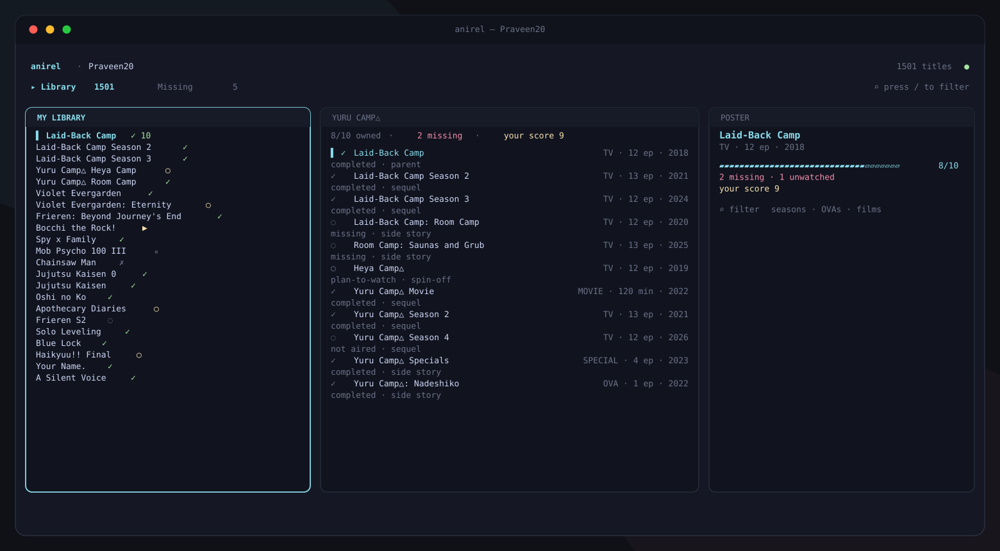
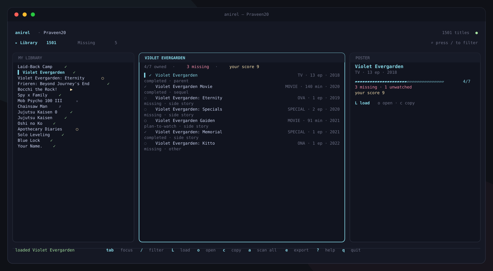
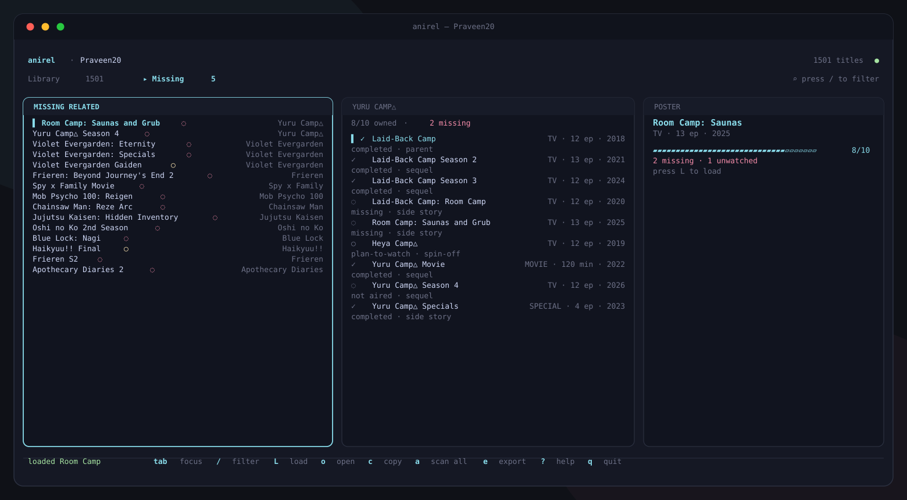

# 🌸 anirel — your MyAnimeList relation graph, in the terminal

> **Find the related anime you haven't watched yet.**

[](https://github.com/Praveensenpai/anirel/releases)
[](https://www.rust-lang.org/)
[](https://github.com/Praveensenpai/anirel)
[](LICENSE)

> [!TIP]
> **Lazy by default.** Nothing is fetched until you press `L`. Your library loads in seconds; the relation graph comes only for the title you actually ask about.

```text
anirel · Praveen20 ─ 1501 titles
▸ Library 1501   Missing 5
┌ MY LIBRARY ─────────┐┌ YURU CAMP△ ───────────┐┌ POSTER ─────────────┐
│ ▌ Laid-Back Camp  ✓10││ 8/10 owned · 2 missing││ Laid-Back Camp      │
│   Season 2          ✓││ ✓ Laid-Back Camp     ││ TV · 12 ep · 2018   │
│   Season 3          ✓││ ✓ Season 2           ││ ▰▰▰▰▰▰▰▰▱▱  8/10     │
│   …                ││ ◌ Room Camp          ││ 2 missing · 1 unwatched│
├─────────────────────┘└──────────────────────┘└──────────────────────┘
  L load · o open · / filter · ? help · q quit
```

---

## 📸 Showcase

A text-first TUI that fits on a terminal: your library on the left, the franchise you loaded in the middle, and a focused poster card on the right — no images, just the facts.

| Library view | Loaded franchise |
|---|---|
|  |  |

| Missing entries | |
|---|---|
|  | |

---

## 🚀 Install

### 🪄 One-liner

```bash
curl -fsSL https://raw.githubusercontent.com/Praveensenpai/anirel/main/install.sh | bash
```

Downloads the latest release, verifies its SHA-256, installs to `~/.local/bin/anirel`.

### From source

```bash
git clone https://github.com/Praveensenpai/anirel
cd anirel && cargo install --path .
```

---

## ✨ Features

- **⚡ Lazy loading** — the relation graph is fetched on demand (`L`), never all at once
- **📋 Poster card** — title, facts and the franchise completion bar at a glance, with no cover images to render
- **🔀 Dive anywhere** — press `L` on a side story; the pane follows its subtree
- **🧭 Release-date watch order** — sorted by air date, relation edges only label the entries
- **🔎 Both titles matched** — search finds entries by original *and* English title
- **📦 Stable `--json`** — every command speaks machine-readable output
- **🧹 Text-only rendering** — clean output on any terminal, including ones that cannot display images

---

## 🗝️ Keys

| Key | Action |
|---|---|
| `L` | load the franchise of the highlighted title |
| `o` / `Enter` | open it on MyAnimeList |
| `/` | filter (both titles) |
| `1` / `2` | library / missing view |
| `tab` | switch pane focus |
| `a` | full scan, with progress |
| `q` | quit |

---

## 💻 Usage

```bash
anirel                      # open the TUI
anirel related "Yuru Camp"  # everything related to one title
anirel gaps                 # every related entry missing from your library
anirel --json gaps | jq .total_missing
```

In Yuru Camp's case: **8 of 10 owned** — Room Camp, Room Camp: Saunas and Grub, Season 2 Specials and Season 4 are the gaps.

---

## 📜 License

[MIT](LICENSE) © [Praveensenpai](https://github.com/Praveensenpai)